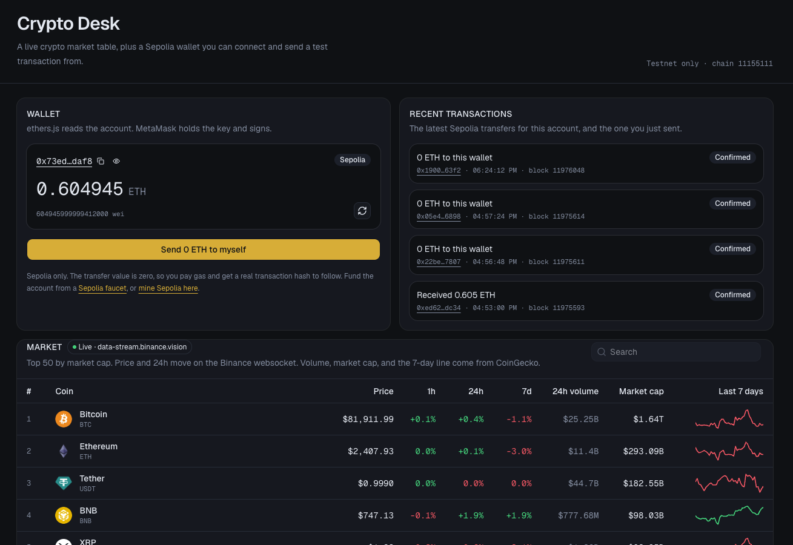

# Crypto Desk

A dark-mode crypto desk: a live market table and a Sepolia wallet you can connect and send a test transaction from.



## What it does

**Market.** The table loads the top 50 coins by market cap from CoinGecko (price context, 24h volume, market cap, and a 7-day sparkline). Last price and the 24h move update from the Binance mini-ticker WebSocket (`stream.binance.com`, with `data-stream.binance.vision` as a fallback). Search pins a coin that is outside the top 50.

**Wallet.** Connect an injected wallet (MetaMask or similar) with ethers.js. The panel shows the address, Sepolia ETH balance, and recent activity from Blockscout. Sending a test transaction submits a 0-value transfer to your own address on Sepolia (chain `11155111`) and tracks it from signing through confirmation.

## Stack

- [Next.js](https://nextjs.org) (App Router) and React
- [Tailwind CSS](https://tailwindcss.com) and [shadcn/ui](https://ui.shadcn.com)
- [ethers.js](https://docs.ethers.org) for the Sepolia wallet
- Binance WebSocket for live ticks, CoinGecko for market snapshots

## Getting started

```bash
npm install
npm run dev
```

Open [http://localhost:3000](http://localhost:3000). A browser wallet is only needed for the Sepolia panel; the market table works without one.
